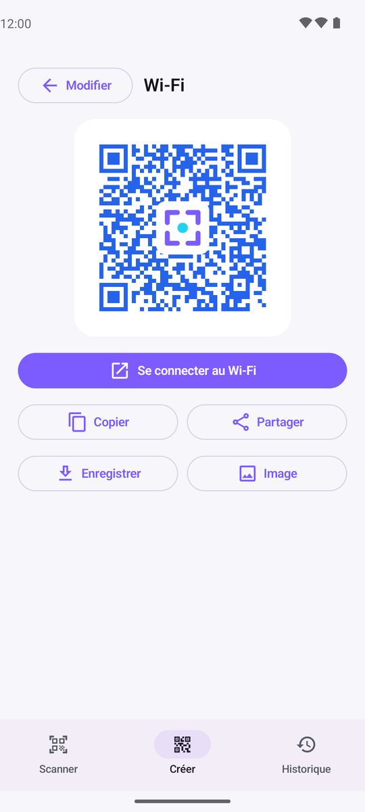
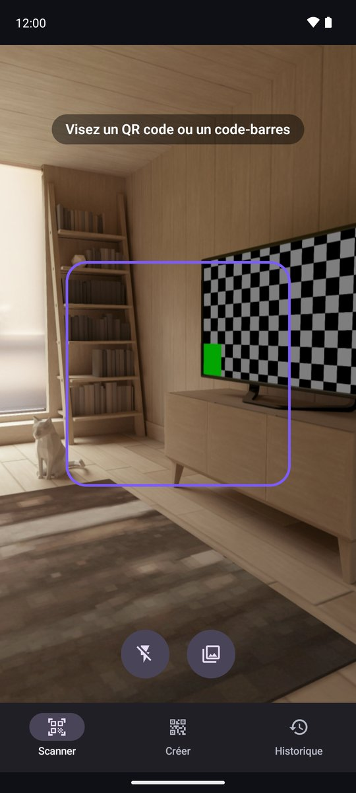

# QR Studio

[](https://github.com/Floran-grmxx/QR-Studio/releases/latest) [](LICENSE)

Android app to **turn anything into a QR code** (link, text, Wi-Fi, contact, email, SMS, phone, location, file/image) and **scan** them with a built-in reader.

## Screenshots

<p align="center">
  
  
  
  
</p>

## Download

📦 [Latest APK](https://github.com/Floran-grmxx/QR-Studio/releases/latest) (Android 8.0+)

🔄 **Automatic updates** via [Obtainium](https://github.com/ImranR98/Obtainium): add the URL `https://github.com/Floran-grmxx/QR-Studio` in the app — it installs the APK and offers each new release.

## Features

- **Create**: 9 QR code types with dedicated forms, 6 ink colors, optional logo in the center. Preview, share, save to gallery.
- **Scan**: real-time camera scanning (CameraX) with pinch-to-zoom, tap-to-focus, flashlight and vibration on detection. Decodes QR codes **and** regular barcodes (EAN, UPC, Code 128, Data Matrix, Aztec, PDF417…). Import from gallery. Context actions based on content (open a link, call, join a Wi-Fi network, add a contact…).
- **History**: every created and scanned QR — search, filters, pinning, deletion. JSON export/import to switch devices or share. Any entry can be **reopened pre-filled** in the Create screen.
- **Widget**: the most recently pinned QR right on the home screen (e.g. guest Wi-Fi).
- **Shortcut**: long-press the icon → "Scan".

## Stack

- Kotlin · Jetpack Compose (Material 3) · Navigation Compose
- **ZXing core**: code encoding / decoding
- **CameraX**: preview + image analysis
- minSdk 26 · targetSdk 36 · Java 17 · AGP 9.1.1 · Gradle 9.3.1
- No DI, no Room/DataStore/Retrofit (project conventions); widget built with RemoteViews (no Glance)

## Build

```bash
./gradlew assembleDebug      # ou gradlew.bat sous Windows
./gradlew testDebugUnitTest  # tests unitaires (détection de types, formats, parsing inverse)
```

> Set `sdk.dir` in `local.properties` (forward slashes on Windows).

## Notes

A QR code stores ~2.9 KB at most. Files/images are embedded as base64:
images are automatically shrunk to a thumbnail so they fit, files that are too
large are explicitly rejected (a physical limit of the format, no hosting backend).
