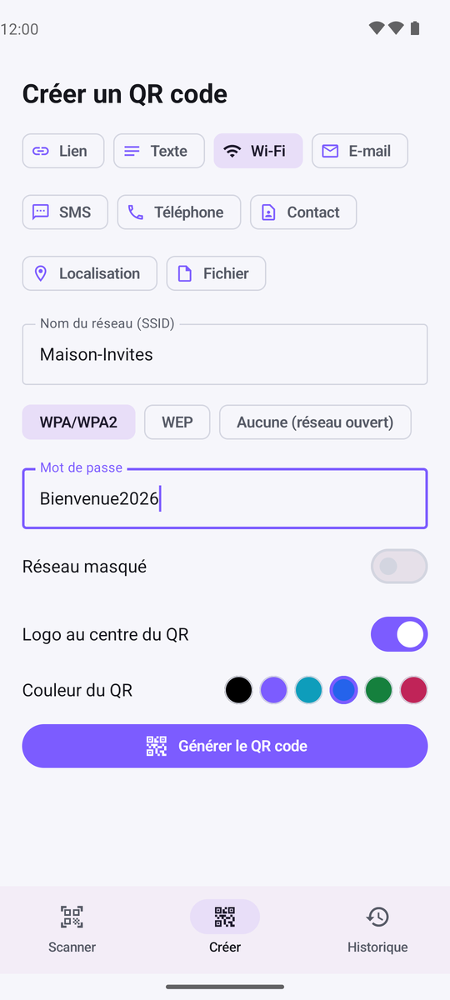
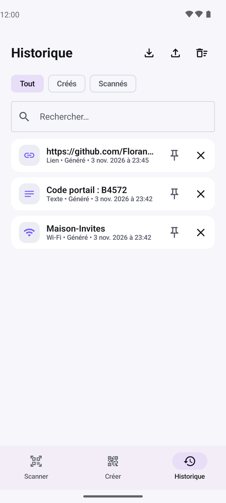

# QR Studio

[](https://github.com/Floran-grmxx/QR-Studio/releases/latest) [](LICENSE)

Application Android pour **tout transformer en QR code** (lien, texte, Wi-Fi, contact, e-mail, SMS, téléphone, localisation, fichier/image) et les **scanner** avec un lecteur intégré.

## Captures

<p align="center">
  
  
  
  
</p>

## Télécharger

📦 [Dernier APK](https://github.com/Floran-grmxx/QR-Studio/releases/latest) (Android 8.0+)

🔄 **Mises à jour automatiques** via [Obtainium](https://github.com/ImranR98/Obtainium) : ajouter l'URL `https://github.com/Floran-grmxx/QR-Studio` dans l'app — elle installe l'APK et propose chaque nouvelle release.

## Fonctionnalités

- **Créer** : 9 types de QR codes avec formulaires dédiés, 6 couleurs d'encre au choix, logo optionnel au centre. Aperçu, partage, enregistrement dans la galerie.
- **Scanner** : lecture caméra en temps réel (CameraX) avec pinch-to-zoom, tap-to-focus, lampe torche et vibration à la détection. Décode les QR codes **et** les codes-barres classiques (EAN, UPC, Code 128, Data Matrix, Aztec, PDF417…). Import depuis la galerie. Actions contextuelles selon le contenu (ouvrir un lien, appeler, rejoindre un Wi-Fi, ajouter un contact…).
- **Historique** : tous les QR créés et scannés — recherche, filtres, épinglage, suppression. Export/import JSON pour changer d'appareil ou partager. Toute entrée peut être **rouverte pré-remplie** dans l'écran Créer.
- **Widget** : le QR épinglé le plus récent directement sur l'écran d'accueil (ex. Wi-Fi invités).
- **Raccourci** : appui long sur l'icône → « Scanner ».

## Stack

- Kotlin · Jetpack Compose (Material 3) · Navigation Compose
- **ZXing core** : encodage / décodage des codes
- **CameraX** : prévisualisation + analyse d'images
- minSdk 26 · targetSdk 36 · Java 17 · AGP 9.1.1 · Gradle 9.3.1
- Pas de DI, pas de Room/DataStore/Retrofit (conventions projet) ; widget en RemoteViews (pas de Glance)

## Build

```bash
./gradlew assembleDebug      # ou gradlew.bat sous Windows
./gradlew testDebugUnitTest  # tests unitaires (détection de types, formats, parsing inverse)
```

> Renseigner `sdk.dir` dans `local.properties` (forward slashes sous Windows).

## Notes

Un QR code stocke ~2,9 Ko maximum. L'embarquement de fichiers/images se fait en base64 :
les images sont automatiquement réduites en miniature pour tenir, les fichiers trop
lourds sont explicitement refusés (limite physique du format, pas de backend d'hébergement).
